<div align="center">


<a href="https://github.com/Ziod2812/DoiZ-Shell"></a>

<br>


<br>

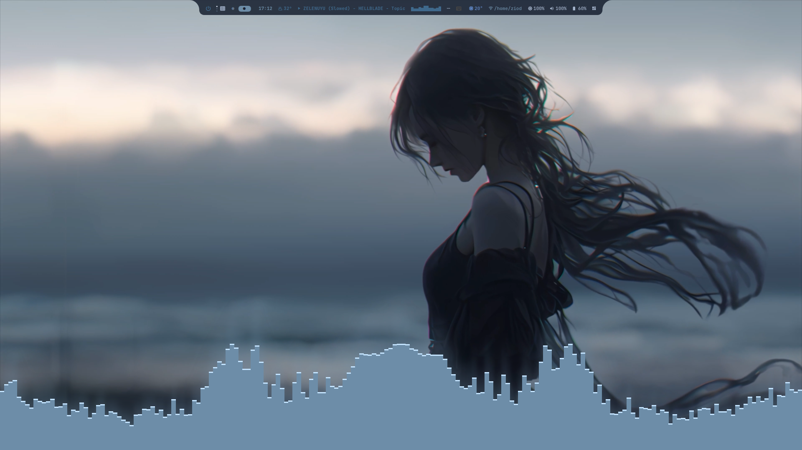

<sub>Every color you see comes from the wallpaper.</sub>

<br><br>

[**✨ Features**](#-features) &nbsp;•&nbsp; [**📸 Gallery**](#-gallery) &nbsp;•&nbsp; [**🔄 Old vs new**](#-old-vs-new) &nbsp;•&nbsp; [**🎨 Theme engine**](#-theme-engine) &nbsp;•&nbsp; [**📦 Install**](#-install) &nbsp;•&nbsp; [**⌨️ Keybinds**](#️-keybinds) &nbsp;•&nbsp; [**📁 Layout**](#-directory-layout) &nbsp;•&nbsp; [**🧰 Guides**](#-guides) &nbsp;•&nbsp; [**🛠️ Changelog**](#️-changelog-and-notes)

</div>

---

## ✨ Features

<table>
<tr>
<td width="50%" valign="top">

### 🎨 Dynamic theme
Colors are extracted from the current wallpaper, **image or video**, and applied live to the bar, every Quickshell panel, btop, cava, kitty, GTK / Thunar and the icon theme.

### 🧩 Quickshell shell
Dashboard, Control Center, launcher, settings, clipboard history, network, volume, brightness, battery, media, weather and date popups, all in one consistent style (4 px radius, JetBrainsMono Nerd Font).

### 📊 Top bar
Power menu, app drawer, workspaces, clock (hover to see the date), weather, now playing with a cava visualizer, and a drawer with tray, temperature, network, brightness, volume and battery.

### 🧭 Navigation
A workspace overview (`Super + Tab`), an `Alt + Tab` window switcher with live previews, and a dock that slides in from the bottom edge.

</td>
<td width="50%" valign="top">

### 🖼️ Wallpapers
Images and videos (mpvpaper) with awww transitions, ffmpeg thumbnails, a color filter, a large live preview and automatic restore at login.

### 🔐 Login and lock
An SDDM theme with a looping video background and a Quickshell lock screen with clock, system stats, calendar, media controls and a live cava, both styled by the same theme.

### ♾️ Infinite Desktop v2
Every window floats and can be moved, resized and navigated by keyboard. Auto Arrange Grid when you want order back.

### ⚔️ Close effects
**Judgement Cut** (Vergil), Portal, Ice, Glass Break and Black Hole, with a live picker and a test mode.

### 🌗 Dark Mode button
Switches GTK, Qt, Firefox, Chromium, Electron and icons while the shell keeps following the wallpaper.

</td>
</tr>
</table>

---

## 📸 Gallery

<table>
<tr>
<td colspan="2" align="center">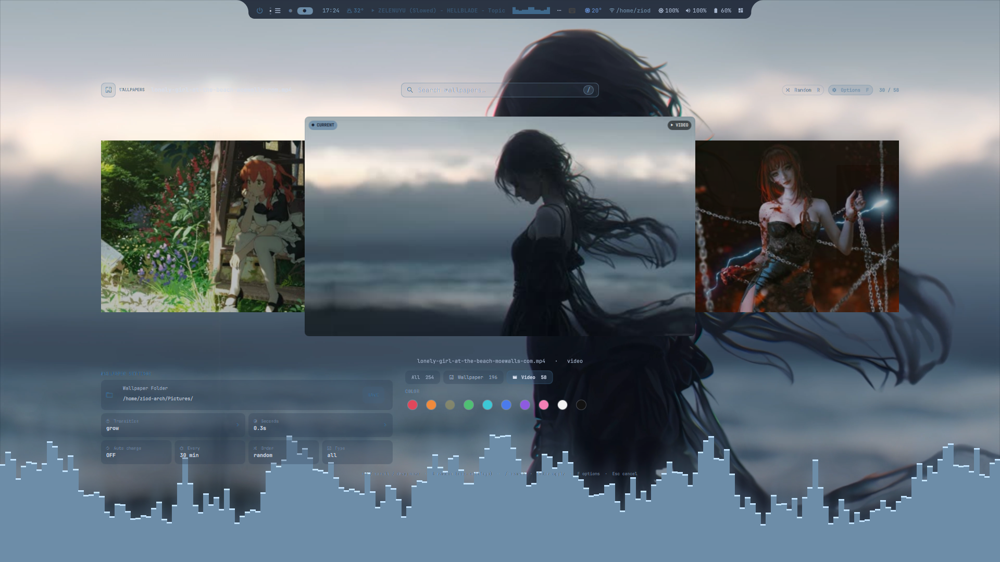<br><b>🖼️ Wallpaper picker</b><br><sub><code>Super + Shift + W</code> — carousel of images and videos, search bar, color filter, transitions and auto change</sub></td>
</tr>
<tr>
<td width="50%" align="center">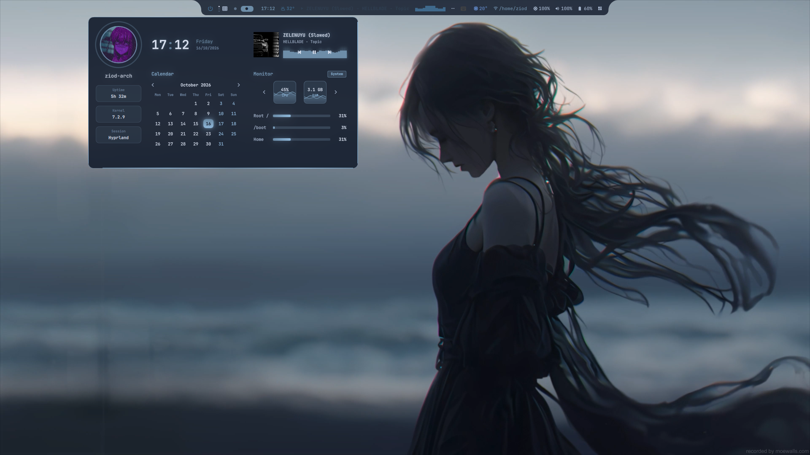<br><b>🗂️ Dashboard</b><br><sub>Profile, clock, calendar, now playing and system monitor under the bar</sub></td>
<td width="50%" align="center">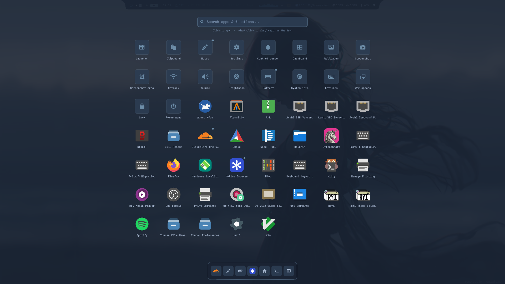<br><b>🚀 Launcher</b><br><sub><code>Super</code> — apps and shell functions in one searchable grid, right-click to pin to the dock</sub></td>
</tr>
<tr>
<td width="50%" align="center">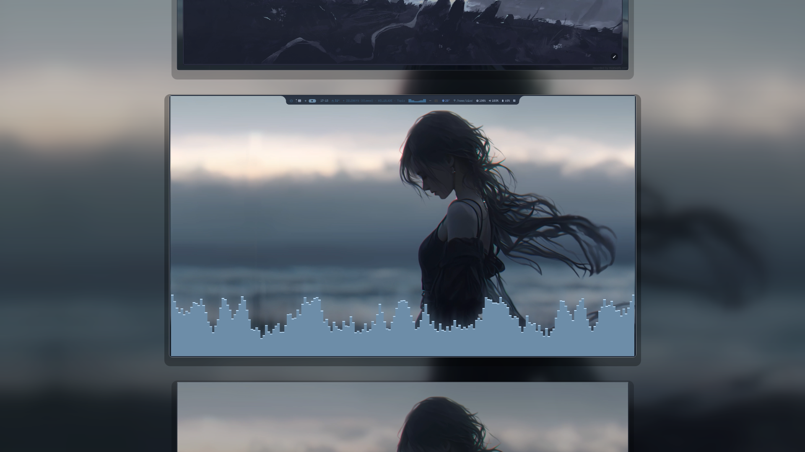<br><b>🪟 Workspace overview</b><br><sub><code>Super + Tab</code> — a vertical strip of live workspaces</sub></td>
<td width="50%" align="center">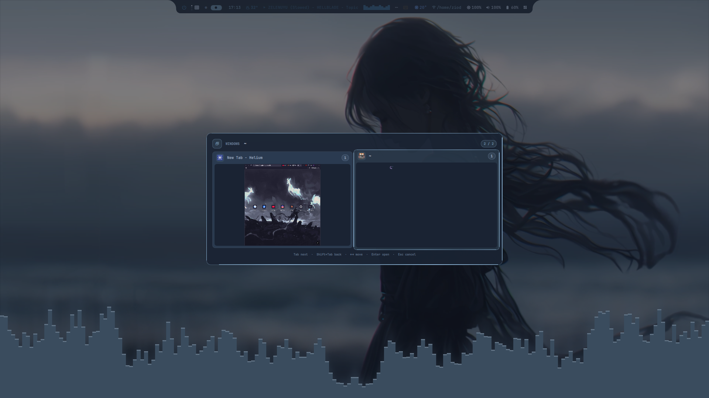<br><b>🔀 Window switcher</b><br><sub><code>Alt + Tab</code> — previews of every open window</sub></td>
</tr>
<tr>
<td width="50%" align="center">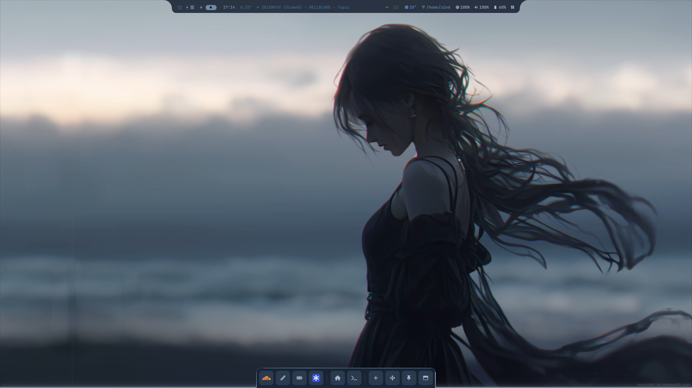<br><b>⚓ Dock</b><br><sub>Pinned apps with add, move, pin and window shortcuts</sub></td>
<td width="50%" align="center">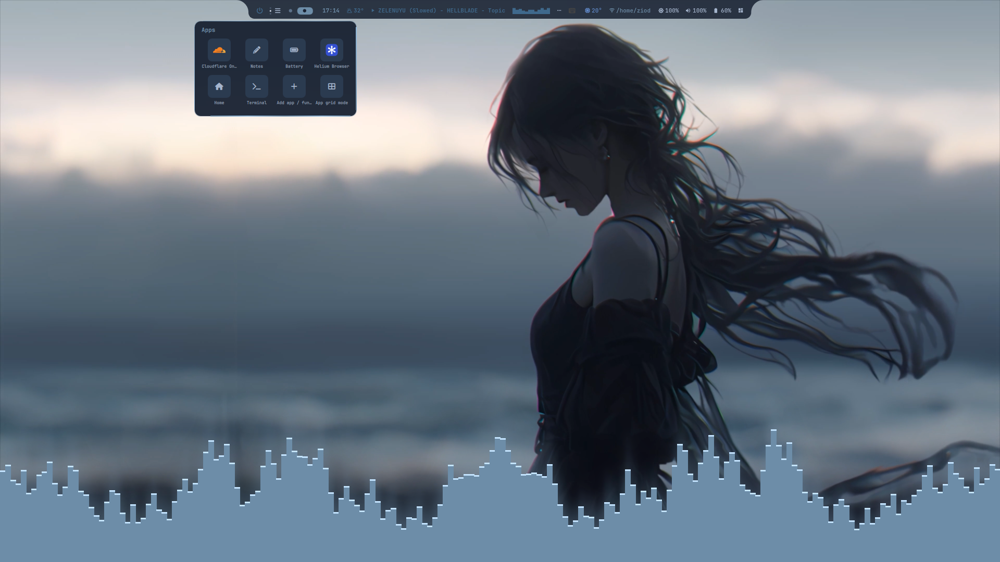<br><b>📌 Apps popup</b><br><sub>Pinned apps from the bar, with the desktop cava behind</sub></td>
</tr>
<tr>
<td width="50%" align="center">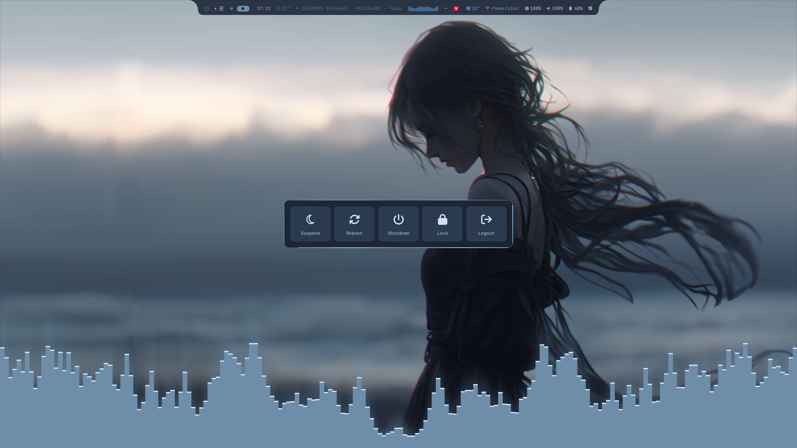<br><b>⏻ Power menu</b><br><sub>Suspend, reboot, shutdown, lock and logout from the bar's left icon</sub></td>
<td width="50%" align="center">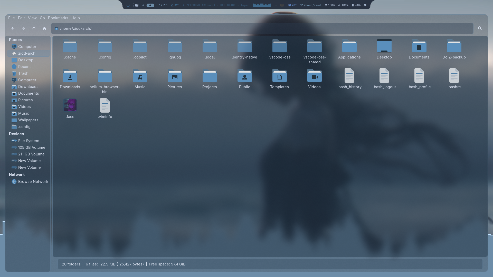<br><b>📁 Thunar</b><br><sub>Translucent, rounded, wallpaper-coloured Papirus icons</sub></td>
</tr>
<tr>
<td width="50%" align="center">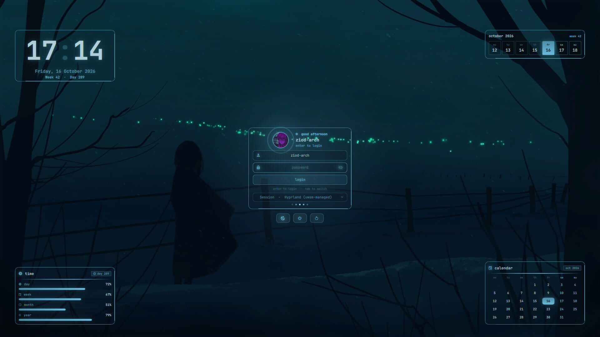<br><b>🔑 SDDM login</b><br><sub>Video background with clock, week progress and calendar widgets</sub></td>
<td width="50%" align="center">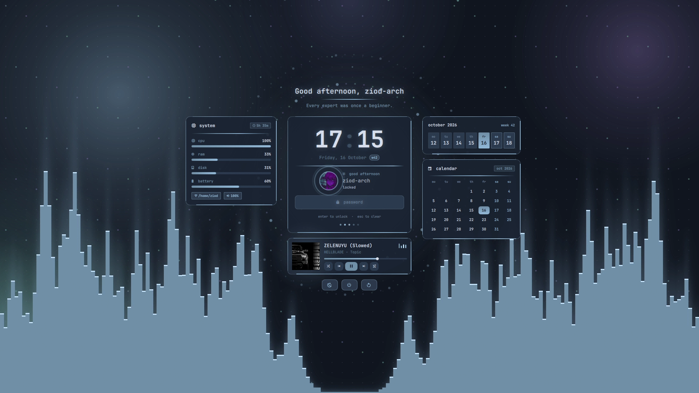<br><b>🔒 Lock screen</b><br><sub><code>Super + L</code> — system stats, calendar, media controls and cava</sub></td>
</tr>
</table>

---

## 🔄 Old vs new

Compared with the first public version of this repository (Waybar + hyprlock), this version replaces most of the visible shell with Quickshell panels. The core of the setup is unchanged.

### ✅ What stays the same

| Area | Same in both versions |
|---|---|
| Base | Arch Linux, Hyprland 0.55+ with the Lua config, MIT license |
| Install | `install.sh` installs packages, moves the old config to `~/DoiZ-backup/date-..._time-...`, copies `dotfiles/` into `~/.config` |
| Theme engine | `apply-theme.py` reads the wallpaper (image or first frame of a video) with ColorThief and writes `theme.conf`; GTK3 uses `DoiZ-Dyn-A` / `DoiZ-Dyn-B`; btop and cava reload with `SIGUSR2` |
| Wallpapers | awww and mpvpaper, video thumbnails, restore at login |
| Infinite Desktop v2 | Same bundled scripts, `Super + Shift + D`, `Super + D`, `Super + Shift + A`, arrow-key bindings |
| Close effects | Judgement Cut, Portal, Ice, Glass Break, Black Hole on `Super + Shift + B`, `Super + Ctrl + Shift + B`, `Super + Alt + B` |
| Shell basics | Control Center (`Super + N`), Settings (`Super + I`), clipboard (`Super + V`), keybind help (`Super + H`) |
| Capture and media | Screenshot, area screenshot, `wf-recorder` recording binds, media keys |
| Dark Mode | The same button and the same GTK / Qt / portal / icon switching |
| Look | 4 px radius, JetBrainsMono Nerd Font, every color taken from the wallpaper |

### 🆕 What changed

| Area | Old version | New version |
|---|---|---|
| Top bar | Waybar + `waybar-cava`, files in `dotfiles/waybar/` | Quickshell bar (`quickshell/bar`) with power menu, app drawer, hover clock, weather / media / date popups |
| Lock screen | hyprlock | Quickshell lock screen (clock, stats, calendar, media, cava) |
| Login | None | SDDM theme `sddm/doiz` with a video background, installed and enabled by `install.sh` |
| Panels | notifd, controlcenter, launcher, clipboard, network, volume, brightness, battery, keybinds | Also dashboard, dock, powermenu, settings, window switcher, workspace overview, screenshot, effects, cava desktop, media / weather / date popups, sysinfo |
| Wallpaper picker | A tab inside the launcher | Its own module on `Super + Shift + W` with search, color filter, random and options |
| Theme scripts | `dotfiles/waybar/scripts/apply-theme.py` | `dotfiles/theme/scripts/` (`apply-theme.py`, `bar-glass.py`, `doiz_icons.py`) |
| Packages | `waybar-cava`, hyprlock | Both removed; `sddm`, `qt6-multimedia`, `qt6-shadertools` added |
| Final install check | Waybar cava module | Quickshell bar files |
| New keys | none | `Super + Tab`, `Super + Shift + Tab`, `Alt + Tab`, `Alt + Shift + Tab`, `Super + Alt + W`, `Super + C` |
| `Super + M` | Media popup: save the hover spot on the Waybar music module | Open Spotify |
| Infinite Desktop canvas | Pan with `Super + Shift` + mouse, zoom with `Super + Alt + scroll`, reset with `Super + Alt + A` | These three binds are empty in `keybinds.lua`, so they are no longer documented |
| Gallery | Control Center, Settings, launcher, battery, btop, cava, ... | Dashboard, launcher grid, overview, window switcher, dock, power menu, Thunar, SDDM, lock screen, wallpaper picker |

---

## 🎨 Theme engine

Change the wallpaper and the whole desktop follows.

<div align="center">
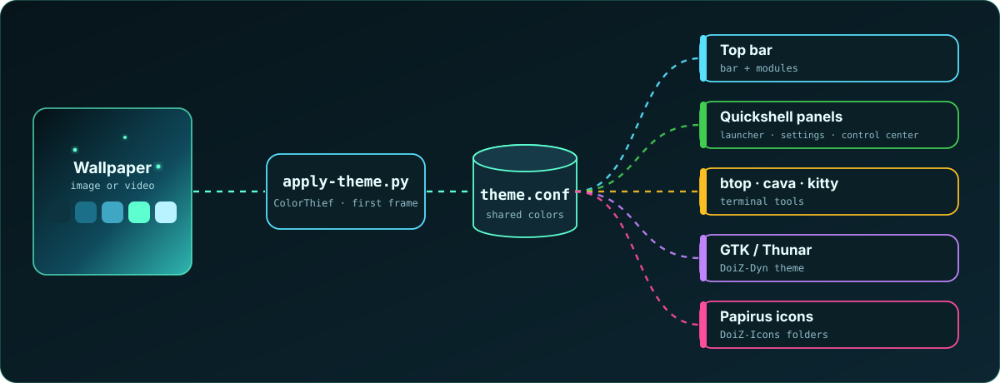
</div>

- Videos: the first frame of the new video is extracted and used for the colors.
- GTK3 apps restyle instantly: the engine alternates two wrapper themes (`DoiZ-Dyn-A` / `DoiZ-Dyn-B`).
- btop and cava are recoloured by sending `SIGUSR2` to the running instances.

---

## 📦 Install

> **Requirements:** Arch Linux, Hyprland **0.55 or newer** (Lua config), a Wayland session, SDDM 0.21+ built for Qt 6.

```bash
git clone https://github.com/Ziod2812/DoiZ-Shell.git
cd DoiZ-Shell
chmod +x install.sh
./install.sh
```

What the installer does:

1. Installs packages from `packages/arch.txt` and `packages/aur.txt` (yay is bootstrapped when missing).
2. Moves your old config to `~/DoiZ-backup/date-<Y-m-d>_time-<H-M-S>` instead of mixing it in.
3. Copies every folder of `dotfiles/` into `~/.config`, merges `xdg-desktop-portal`, sets a default Qt palette and dark mode on a fresh install.
4. Installs the SDDM theme to `/usr/share/sddm/themes/doiz`, selects it in `/etc/sddm.conf.d/10-doiz-theme.conf` and enables `sddm.service`.
5. Runs a final check (`jq`, `socat`, `timeout`, `pgrep`, script syntax, Quickshell bar files).

Then **log out and back in** (or start Hyprland) so the session picks up the environment.

> [!TIP]
> Press **`Super + H`** at any time to see every keybind. Run games in *Borderless Windowed*, not exclusive Fullscreen.

### 🧱 Stack

| Part | Tool |
|---|---|
| Compositor | Hyprland (Lua config) |
| Shell | Quickshell (QML) |
| Bar | Quickshell (`quickshell/bar`) + cava |
| Display manager | SDDM (`sddm/doiz`, video background) |
| Wallpaper | awww, mpvpaper |
| Terminal | kitty |
| File manager | Thunar + Papirus icons |
| Clipboard | cliphist + wl-clipboard |
| Recording | wf-recorder |
| Lock / idle | Quickshell lock screen, hypridle |
| Theme engine | `apply-theme.py` (ColorThief) |

---

## ⌨️ Keybinds

Every bind below is defined in `dotfiles/hypr/config/keybinds.lua` and listed in the help popup (`Super + H`).

### 🚀 Apps
| Key | Action |
|---|---|
| `Super` (release) | Launcher |
| `Super + T` | Terminal |
| `Super + W` | Browser (Helium) |
| `Super + E` | File manager |
| `Super + N` | Toggle Control Center / sidebar |
| `Super + I` | Settings |
| `Super + V` | Clipboard history |
| `Ctrl + Shift + Escape` | Task manager (btop in the terminal) |
| `Super + H` | Keybinds help |
| `Super + M` | Spotify |
| `Super + C` | Move the desktop cava between the bottom and the top of the screen |
| `Super + Shift + W` | Wallpaper picker: carousel of images and videos. `←` `→` / scroll to browse, `Enter` or click the centre card to apply, `F` for folder / transition / filters, `Esc` to cancel |
| `Super + Alt + W` | Random wallpaper |

### 🪟 Windows
| Key | Action |
|---|---|
| `Super + Q` | Close |
| `Super + F` | Fullscreen |
| `Super + Alt + F` | Maximize |
| `Super + Alt + Space` | Toggle floating |
| `Ctrl + Super + \` | Center window |
| `Super + P` | Pin (visible on every workspace) |
| `Super + X` (hold, with mouse) | Resize window |
| `Super + hold left mouse button` | Drag the window under the cursor |
| `Alt + Tab` / `Alt + Shift + Tab` | Window switcher, next / previous |

### 🗂️ Workspaces
| Key | Action |
|---|---|
| `Super + 1..0` | Go to workspace 1..10 |
| `Super + Alt + 1..0` | Move window to workspace 1..10 |
| `Ctrl + Super + 1..0` | Go to workspace group (10..100, step 10) |
| `Ctrl + Super + Alt + 1..0` | Move window to workspace group |
| `Super + Tab` / `Super + Shift + Tab` | Workspace overview, next / previous |
| `Super + scroll` | Move through the workspace overview |
| `Super + S` | Toggle special workspace (scratchpad) |
| `Super + Alt + S` | Send window to the special workspace |
| `Ctrl + Super + Shift + ↓` | Bring window back from the special workspace |

### ♾️ Infinite Desktop v2
| Key | Action |
|---|---|
| `Super + Shift + D` | Infinite Desktop ON / OFF |
| `Super + D` | Toggle floating / tiled for all windows on the workspace |
| `Super + Shift + A` | Auto Arrange Grid ON / OFF |
| `Super + ←/→/↑/↓` | Focus / navigate windows |
| `Super + Shift + ←/→/↑/↓` | Move floating window |
| `Super + Alt + ←/→/↑/↓` | Move tiled window |
| `Super + Ctrl + Alt + ←/→/↑/↓` | Resize window |

The Infinite Desktop scripts are bundled in `dotfiles/hypr/scripts/infinite-desktop/` (source: sarodscommits/hyprland-infinitie-desktop-v2, MIT).

While Infinite Desktop is ON, `auto_float.py` floats every new window and every tiled window that is already open. It does nothing while Infinite Desktop is OFF. Infinite Desktop is OFF by default and after every login; turn it on with `Super + Shift + D`.

### ⚔️ Close effects
| Key | Action |
|---|---|
| `Super + Shift + B` | Judgement Cut: Vergil-style space slashes cut the screen into shards that fly apart and swallow every window on it (closing them). Other looks (`portal`, `ice`, `glass`, `blackhole`) via `effect =` in `~/.config/mycfg/blackhole.conf` |
| `Super + Ctrl + Shift + B` | Same effect, test mode (windows are put back, nothing is closed) |
| `Super + Alt + B` | Close-effect picker: live preview of Judgement, Portal, Ice, Glass and Black Hole, TEST / RUN buttons, gold-odds and cooldown sliders |

### 📋 Clipboard
| Key | Action |
|---|---|
| `Super + V` | Open the Quickshell clipboard |
| `Super + Alt + V` | Wipe the clipboard history |

The clipboard uses `cliphist` + `wl-clipboard`, supports text and images, search and image preview.

### 📸 Capture and record
| Key | Action |
|---|---|
| `Print` | Screenshot (full screen) |
| `Super + Shift + S` | Area screenshot: hover snaps to a window, then preview with Copy / Save and pen / rect / arrow drawing |
| `Ctrl + Alt + R` | Start / stop screen recording (no audio) |
| `Super + Alt + R` | Start screen recording with audio |
| `Super + Shift + Alt + R` | Start screen recording of a region |

### ⚙️ System
| Key | Action |
|---|---|
| `Super + L` | Lock screen |
| `Super + Shift + R` | Reload Hyprland |

### 🎵 Media keys
| Key | Action |
|---|---|
| Volume up / down | Change volume by 5% (capped at 100%) |
| Mute / Mic mute | Toggle speakers / microphone |
| Brightness up / down | Change screen brightness by 5% |
| Play / Pause / Next / Previous | Control the active media player |

### ⌨️ Inside apps and popups

| Where | Key | Action |
|---|---|---|
| Launcher | `Tab` | Next mode (Apps / Run / Windows / Wallpaper) |
| Launcher | `↑` / `↓` | Move selection |
| Launcher | `Enter` | Run / open the selected item |
| Launcher | `Esc` | Close |
| Launcher | right-click | Pin / unpin on the dock |
| Window switcher | `Tab` / `Shift + Tab` | Next / previous |
| Window switcher | `←` / `→` | Move |
| Window switcher | `Enter` / `Esc` | Open / cancel |
| Clipboard popup | `↑` / `↓`, `Ctrl + P` / `Ctrl + N` | Move selection |
| Clipboard popup | `Enter` | Copy the selected entry |
| Clipboard popup | `Delete` | Remove the selected entry |
| Network popup | `Enter` / `Esc` | Connect with the typed password / cancel |
| Help popup | `Esc` / `Super + H` | Close |
| Lock screen | `Enter` / `Esc` | Unlock / clear the password |
| Touchpad | 3-finger horizontal swipe | Switch workspace |

---

## 📁 Directory layout

<details>
<summary><b>Show the full tree</b></summary>

```
DoiZ-Shell/
├── README.md
├── install.sh
├── packages/
│   ├── arch.txt
│   └── aur.txt
├── assets/
│   ├── header.svg
│   ├── footer.svg
│   ├── theme-engine.svg
│   ├── screenshots/
│   └── templates/
├── sddm/
│   └── doiz/
├── dotfiles/
│   ├── hypr/
│   │   ├── hyprland.lua
│   │   ├── hypridle.conf
│   │   ├── config/
│   │   ├── local/custom.lua
│   │   └── scripts/
│   │       └── infinite-desktop/
│   ├── theme/
│   │   ├── theme.conf
│   │   └── scripts/
│   ├── quickshell/
│   │   ├── bar/
│   │   ├── dashboard/
│   │   ├── dock/
│   │   ├── launcher/
│   │   ├── lockscreen/
│   │   ├── settings/
│   │   ├── controlcenter/
│   │   ├── notifd/
│   │   ├── powermenu/
│   │   ├── wallpaperpicker/
│   │   ├── windowtab/
│   │   ├── wsoverview/
│   │   ├── clipboard/
│   │   ├── screenshot/
│   │   ├── effects/
│   │   ├── blackhole/
│   │   ├── cavadesk/
│   │   ├── mediapopup/
│   │   ├── weatherpopup/
│   │   ├── datepopup/
│   │   ├── sysinfo/
│   │   ├── network/
│   │   ├── volume/
│   │   ├── brightness/
│   │   ├── battery/
│   │   └── keybinds/
│   ├── cava/
│   ├── btop/
│   ├── kitty/
│   ├── fish/
│   ├── wlogout/
│   ├── gtk-3.0/
│   ├── cursor/
│   ├── mycfg/
│   └── xdg-desktop-portal/
```

</details>

| Folder | Role |
|---|---|
| `dotfiles/hypr/config/` | Every file using the `hl.*` API (Hyprland 0.55+): keybinds, rules, animations, input, monitors |
| `dotfiles/hypr/scripts/` | Session start, lock, record, screenshot, wallpaper and video wallpaper, dark mode, popups, overview and window switcher helpers |
| `dotfiles/theme/scripts/` | `apply-theme.py` and the helpers that turn a wallpaper into `theme.conf` |
| `dotfiles/quickshell/` | One config per panel, started with `qs -c <name>` |
| `dotfiles/quickshell/blackhole/` | Fragment shaders for the close effects (Judgement, Portal, Ice, Glass, Black Hole) |
| `dotfiles/mycfg/` | Personal settings read by the scripts (autostart, settings overrides, blackhole effect) |
| `sddm/doiz/` | SDDM theme with `bg.mp4` as the background |

---

## 🧰 Guides

<details>
<summary><b>🔲 Auto Arrange Grid</b></summary>

`Super + Shift + A` toggles a compact grid layout for app windows on the current workspace. Press it again to stop automatic rearrangement.

</details>

<details>
<summary><b>🌗 Dark Mode</b></summary>

The Dark Mode button in the Control Center runs `~/.config/hypr/scripts/dark-mode.sh toggle`.

| Component | How it changes |
|---|---|
| GTK3, GTK4, libadwaita, Thunar | `color-scheme`, the GTK theme pair (Adwaita / Adwaita-dark, adw-gtk3 / adw-gtk3-dark when present), `gtk-3.0` and `gtk-4.0` `settings.ini` |
| Firefox, Chromium, Electron, Flatpak | `xdg-desktop-portal-gtk` reads `color-scheme` (configured in `~/.config/xdg-desktop-portal/hyprland-portals.conf`) |
| Qt (qt6ct) | `apply-theme.py --system dark\|light` rewrites the qt6ct palette |
| Icons (Thunar, GTK, Qt) | Papirus-Dark in dark mode, Papirus-Light in light mode |
| Top bar, Quickshell, btop, cava, kitty | Unchanged, they keep following the wallpaper colors |

To change the wallpaper-driven parts too: `DOIZ_THEME_SCOPE=all ~/.config/hypr/scripts/dark-mode.sh toggle`.

Notes:

- Firefox must be set to the System theme (auto). Chromium must be in Device or GTK mode.
- Running Qt apps usually update by themselves; reopen the app if they do not.
- Log in again once after installing so `xdg-desktop-portal` picks up the right environment variables.

</details>

<details>
<summary><b>🔑 SDDM theme</b></summary>

The installer copies `sddm/doiz` to `/usr/share/sddm/themes/doiz` and writes `/etc/sddm.conf.d/10-doiz-theme.conf`. To change the background, replace `bg.mp4` (and `poster.jpg`) in the theme folder. The avatar is read from `~/.face`.

The theme needs a Qt 6 build of SDDM (`sddm-greeter-qt6`) and `qt6-multimedia-ffmpeg`.

</details>

<details>
<summary><b>🕐 Clock and popups</b></summary>

The bar clock shows `HH:mm`; hover it to see the weekday and date, click it to open the calendar popup. The weather, media and system chips open their own popups under the bar.

</details>

<details>
<summary><b>🔳 Window corners</b></summary>

Every window has 4 px rounded corners, the same radius as the bar modules (`rounding` in `~/.config/hypr/config/decoration.lua`). Thunar keeps 12 px through its own rule in `windowrules.lua`, because its GTK theme (`gtk.css.template`) copies the lock screen: 12 px panel, 8 px cards and buttons, 1 px accent borders. Fullscreen windows stay square. Apply a change with `hyprctl reload`.

</details>

<details>
<summary><b>♻️ Wallpaper restore</b></summary>

The path of the last wallpaper is saved in `~/.local/state/doiz/current-wallpaper` by the wallpaper picker, `wallpaper.sh` and `video-wallpaper.sh`. `doiz-session` runs `restore-wallpaper.sh` at login, right after `awww-daemon` is up: an image is set with `awww img` and no transition, a video goes through `video-wallpaper.sh` and mpvpaper. If the file is missing or the path no longer exists (for example the wallpaper folder is on a drive that is not mounted yet), it falls back to `awww restore`. The theme colors are not recalculated, because `theme.conf` already holds the colors of that wallpaper.

</details>

<details>
<summary><b>🎬 Video wallpaper</b></summary>

- `video-wallpaper.sh`: switches to a video through `video-wallpaper-transition.sh` (an awww transition into the new video's first frame), then starts mpvpaper with `panscan=1.0` so the video fills the screen like awww does. The wallpaper picker passes the transition type and duration chosen in its options (`F`), so videos use the same effect as images. Outside the picker, change the effect with `DOIZ_VIDEO_TRANSITION` (any awww transition type such as `grow`, `wave`, `fade`, `wipe`, `center`, `outer`, `random`) and its length with `DOIZ_VIDEO_TRANSITION_DURATION` (seconds, default 1).
- `video-thumbnails.sh`: prints `video<TAB>thumbnail` lines for every video in the wallpaper folder, generating missing thumbnails with `ffmpeg` (one frame at 1 s, or at 0 s for shorter videos) into `~/.cache/doiz/video-thumbs`. Thumbnails are keyed by path and modification time, so they are made once and refreshed when the file changes. The launcher shows them in the Wallpaper grid as they become ready and marks videos with a small play badge.
- `video-theme-frame.sh`: extracts the first frame of the new video for theme colors.
- `video-wallpaper-stop.sh`: stops mpvpaper and keeps the last frame on awww. It is called before an image wallpaper is set (Launcher and `wallpaper.sh`), because mpvpaper sits above awww and would otherwise cover the new image.

</details>

<details>
<summary><b>🧿 Icon theme</b></summary>

Thunar's folders, trash and sidebar icons come from Papirus (folders recolored to the wallpaper accent) (`papirus-icon-theme` in `packages/arch.txt`). `install.sh` runs `dark-mode.sh icons` to apply it, and the Dark Mode button switches between `Papirus-Dark` and `Papirus-Light`. If a theme is not installed, the current icons are left as they are.

- Other icon pack: `DOIZ_ICON_DARK=Name DOIZ_ICON_LIGHT=Name ~/.config/hypr/scripts/dark-mode.sh icons`, or edit the two variables at the top of `dark-mode.sh`.
- Folder color: follows the wallpaper. `apply-theme.py` builds `~/.local/share/icons/DoiZ-Icons-<id>` (a new name on every run, so running apps reload; the previous one is kept until the next run) that inherits Papirus and recolors every blue folder, the home and desktop icons and the folder variants (documents, downloads, music, ...) with the wallpaper accent. It runs on every wallpaper change and on the Dark Mode button. To rebuild by hand: `python3 ~/.config/theme/scripts/apply-theme.py --icons`.
- Single icons (trash, home, ...): create `~/.local/share/icons/DoiZ/` with an `index.theme` that has `Inherits=Papirus-Dark,hicolor`, put `user-trash.svg` and `user-trash-full.svg` in `places/48/`, run `gtk-update-icon-cache -f ~/.local/share/icons/DoiZ`, then set `DOIZ_ICON_DARK=DoiZ` (and `DOIZ_ICON_LIGHT=DoiZ`). The wallpaper-colored theme then inherits that one instead of Papirus.

</details>

<details>
<summary><b>📁 Thunar theme</b></summary>

`.config/gtk-3.0/gtk.css.template` styles Thunar (translucent, rounded, wallpaper colors). GTK3 reads `~/.config/gtk-3.0/gtk.css` only once per app, so a running Thunar never sees changes to that file. `apply-theme.py` therefore renders the template into a small wrapper theme (`~/.local/share/themes/DoiZ-Dyn-A` or `DoiZ-Dyn-B`) that imports your real GTK theme (Adwaita, adw-gtk3, ...) and adds the wallpaper colors on top. On every wallpaper/mode change it writes the other slot and switches `gtk-theme` to it, which makes every open GTK3 window restyle instantly. `gtk-3.0/gtk.css` is kept empty on purpose so it cannot override the live theme. The real base theme is remembered as `gtk_base` in `theme.conf`, and `dark-mode.sh` passes it along, so the Dark Mode button still switches Adwaita / Adwaita-dark and adw-gtk3 / adw-gtk3-dark.

btop and cava are recolored by sending `SIGUSR2` to every running `btop` and `cava` of your user, however they were started. If a part of Thunar does not look right, inspect the widget classes with `GTK_DEBUG=interactive thunar` and adjust the `.thunar` selectors in the template.

- **Switching video wallpapers**: at any second you change, the exact frame mpvpaper is showing (taken through mpv's `screenshot-to-file`, video paused) is frozen into awww, then the transition runs into the new video's second 0 and the new video plays from 0.

</details>

<details>
<summary><b>📦 install.sh details</b></summary>

- The old configuration is moved to `~/DoiZ-backup/date-<year-month-day>_time-<hour-minute-second>` instead of being mixed into `~/.config`.
- The `xdg-desktop-portal` directory is merged instead of replaced: only files with the same name and different content are moved to the backup, your other portal files are kept.
- Fresh install (no `~/.config/qt6ct/qt6ct.conf` yet): sets a default Qt palette and dark mode for GTK. Reinstalling does not overwrite your Dark/Light choice.
- The top bar is a Quickshell config (`~/.config/quickshell/bar`, started by `doiz-session` through the `doiz-bar` supervisor, which restarts `qs -c bar` if it exits). Waybar is no longer used or installed; an old `~/.config/waybar` folder can be deleted.
- The final check needs `jq`, `socat`, `timeout`, `pgrep` and the Dark Mode, video wallpaper and portal configuration scripts.
- The Infinite Desktop scripts are taken from the bundled folder and only downloaded from GitHub when missing.

</details>

<details>
<summary><b>🎨 DoiZ icon set (Thunar)</b></summary>

`dotfiles/theme/scripts/doiz_icons.py` draws the folders, Places (home, Downloads, Documents, Pictures, Music, Videos, Desktop, Templates, Public, Trash, Computer, drives, Recent, Network) and about 45 file types (shell, Python, Lua, QML, JS/TS, JSON, YAML, TOML, Markdown, HTML, CSS, C/C++, PDF, Office, image, audio, video, archives, disk images, AppImage, fonts, ...) as flat two-tone SVGs built from four steps of the wallpaper accent (no outlines or gradients, one pale glyph per icon, small mono label bands on file types; set `TYPE_HUE_SHIFT = 1` in `doiz_icons.py` for a different hue per file type). Files Thunar can preview (images, videos, PDFs, ...) show their real thumbnail through `tumbler`; the drawn icon is only the fallback. Pictures (png, jpg, webp, gif, bmp, tiff) and videos (mp4, webm, mkv, mov, avi, ..., one frame grabbed with `ffmpeg`) are drawn inside a flat rounded dark-accent frame by `hypr/scripts/doiz-thumbnailer.py`, registered by `install.sh` as `~/.local/share/thumbnailers/doiz-image-frame.thumbnailer` (needs tumbler 0.2+ with Priority support, i.e. 4.18+; older versions show plain thumbnails). The frame uses the accent saved by `apply-theme.py` in `~/.local/state/doiz/icon-accent`; thumbnails already cached keep the old color after a wallpaper change until you run `rm -rf ~/.cache/thumbnails`. `apply-theme.py` writes them into `~/.local/share/icons/DoiZ-Icons-<id>`, which inherits Papirus for everything not drawn here, so apps outside Thunar keep their icons. `install.sh` adds Downloads, Documents, Pictures, Videos, Music, Wallpapers and `.config` to the Thunar sidebar (`~/.config/gtk-3.0/bookmarks`) and copies `assets/templates/` into your Templates folder for the right click New Document menu (txt, md, sh, py, lua, qml, json, html, desktop). Add a file type by appending a row to `FILE_TYPES` in `doiz_icons.py`.

</details>

---

## 🛠️ Changelog and notes

<details>
<summary><b>Fixed in the review pass</b></summary>

- **The whole Hyprland config used to fail to load**: files in `config/` called `hyprctl.keyword(...)`, which does not exist in the real Lua API of Hyprland 0.55+. Everything now uses `hl.config()`, `hl.monitor()`, `hl.workspace_rule()`, `hl.curve()`, `hl.animation()`, `hl.device()`, `hl.window_rule()` and `hl.gesture()`.
- **`Super+0..9` workspace switching did nothing**: a string-concatenation bug produced the bogus dispatcher `workspaceworkspace`. It now uses `hl.dsp.focus({workspace=...})`.
- **`Super + S` (special workspace toggle)** shelled out to `hyprctl dispatch togglespecialworkspace`; it now uses the native Lua dispatcher `hl.dsp.workspace.toggle_special("special")`.
- **`env.lua` never ran**: every `setenv(...)` lived in `M.setup()` and nobody called it. It now runs as soon as it is required.
- **Conflicting settings**: `mouse.lua`/`input.lua` and `visuals.lua`/`misc.lua` set the same keys to different values. Each category now has a single source.
- **No autostart existed** (no waybar, no hypridle, no quickshell), which caused the "notification server already registered" warning. `config/autostart.lua` was added and `doiz-session` guards each command with `pgrep`. `notification = "swaync-client"` (there is no swaync config) was removed from `programs.lua` and replaced with the Quickshell `controlcenter`.
- **`layerrules.lua` blur never matched** because of wrong namespaces (`"quickshell"`/`"swaync"` instead of the real `doiz_control_center`, `doiz-network-panel`, ...). Fixed with the regex `^doiz[-_]`.
- **`swaync` cleaned up**: the dead `targets["swaync"]` was removed from `apply-theme.py` and `theme.conf`.
- **`awww`**: uses the current wallpaper daemon name and binary; there is no `swww` fallback any more.
- **Native Wayland for Electron**: `electron-flags.conf`, `code-flags.conf` and `discord-flags.conf` with `--enable-features=UseOzonePlatform --ozone-platform=wayland`.
- **Silent screenshot failures**: the screenshot binds write to `~/Pictures/Screenshots` but nothing created it. `mkdir -p` was added.
- **7 empty (0 byte) scripts**: `screenshot.sh`, `screenshot-area.sh`, `lock.sh`, `idle-inhibit.sh`, `reload.sh`, `wallpaper.sh`, `wallpaper-random.sh` are now complete and report through `notify-send`.
- **Screen recording (`Ctrl+Alt+R` / `Super+Alt+R` / `Super+Shift+Alt+R`)**: `record.sh` (`wf-recorder`, start/stop toggle) and all three binds are in place and listed in `Super + H`.
- **Video wallpaper**: switching to an mp4 now plays a real awww transition. The old video is frozen into awww, mpvpaper is stopped, awww transitions to the first frame of the new video (`grow` by default), and only then does mpvpaper start on the same frame, so the hand-over is seamless. The wallpaper service (`WallpaperService.qml`) also scans `.mp4/.webm/.mkv/.mov/.avi` and the wallpaper picker (`Super + Shift + W`) shows a thumbnail with a play badge. One frame of the newly chosen video (falling back to `-ss 0` for videos shorter than 1s) is extracted so `apply-theme.py` can take the dominant color, so **btop, cava and all of Quickshell (the bar included) (which reads `theme.conf`) follow the video's colors**, not just still images.
- **Infinite Desktop v2** is integrated with non-conflicting keys (see above), a bundled copy of its scripts, and `auto_float.py`.
- **`Super + N` / control center IPC**: `controlcenter/shell.qml` has an `IpcHandler` (`toggle`, `hide`) and `doiz-controlcenter` starts the panel without immediately closing it on a cold start.

</details>

<details>
<summary><b>Known limitations</b></summary>

- **Obsidian has no flags file** because `install.sh` copies whole `~/.config/<name>` directories (adding `obsidian/` to the repo would back up your entire Obsidian configuration). Create `~/.config/obsidian/user-flags.conf` manually.
- **`controlcenter`** uses a launcher with a lock and IPC to avoid several instances registering the notification server.
- **The QML and Lua changes above were not built or run on a real Quickshell / Hyprland** (only structure and syntax were checked), so please test them on a real machine.
- **`mycfg/custom-keys.lua` and `mycfg/theme-state.env`** are empty and referenced nowhere; they are left as they are because their original purpose is unknown.
- **Video theme** only takes colors from **the first frame** (second 0) of the new video, not an average over the whole video.

</details>


---

---

## 🙏 Credits

- [sarodscommits/hyprland-infinitie-desktop-v2](https://github.com/sarodscommits/hyprland-infinitie-desktop-v2) — Infinite Desktop v2 scripts (MIT), bundled in `dotfiles/hypr/scripts/infinite-desktop/`
- [Hyprland](https://hyprland.org), [Quickshell](https://quickshell.org), [awww](https://codeberg.org/LGFae/awww), [mpvpaper](https://github.com/GhostNaN/mpvpaper), [cava](https://github.com/karlstav/cava), [btop](https://github.com/aristocratos/btop), [Papirus](https://github.com/PapirusDevelopmentTeam/papirus-icon-theme)

---

<div align="center">

<br>
<sub>MIT licensed. Infinite Desktop scripts: sarodscommits/hyprland-infinitie-desktop-v2 (MIT).</sub>
</div>
